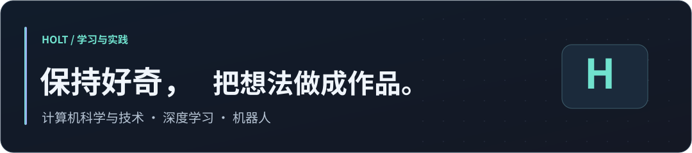
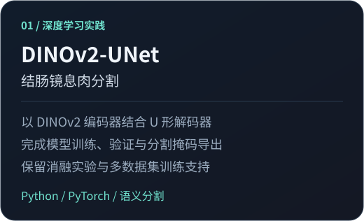
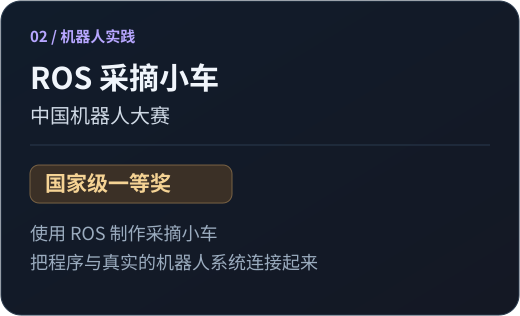

  

<h1 align="center">👋 你好，我是 Holt</h1>

  <strong>泰州学院 · 计算机科学与技术（CS）</strong> 
  对深度学习与 AI 保持好奇，也喜欢动手训练模型、完成自己的项目。

  <a href="https://github.com/Holt-Ze/DinoV2-Unet">医学图像分割</a> &nbsp;·&nbsp;
  深度学习 &nbsp;·&nbsp; ROS 机器人 &nbsp;·&nbsp;
  <a href="https://github.com/Holt-Ze?tab=repositories">项目实践</a>

---

<h2 align="center">🧭 关于我</h2>

  我就读于泰州学院计算机科学与技术专业，关注深度学习和人工智能。 
  我会训练自己的模型，做过基于 DINOv2 与 U-Net 的息肉分割项目。 
  也曾使用 ROS 制作采摘小车，获得<strong>中国机器人大赛国家级一等奖</strong>。

  希望在一次次实验与实践中，更深入地理解模型，也让代码走进真实场景。

<h2 align="center">🔬 项目与经历</h2>

<table>
  <tr>
    <td width="50%" valign="top">
      
    </td>
    <td width="50%" valign="top">
      
    </td>
  </tr>
</table>

  <a href="https://github.com/Holt-Ze/DinoV2-Unet"><strong>查看息肉分割项目 →</strong></a>

<h2 align="center">🛠️ 实践中的技术</h2>

  <strong>模型与研究</strong> &nbsp; Python · PyTorch · DINOv2 · U-Net 
  <strong>机器人实践</strong> &nbsp; ROS · C · Raspberry Pi 
  <strong>开发环境</strong> &nbsp; Linux · Git · GitHub

<h2 align="center">📂 更多作品</h2>

| 项目 | 内容 |
| :--- | :--- |
| [健康风险预测](https://github.com/Holt-Ze/health-risk-prediction) | 结合大数据处理、机器学习与 Web 可视化的健康风险预测系统。 |
| [智能财务系统](https://github.com/Holt-Ze/Development-of-Intelligent-Finance-Systems) | 智能财务系统课程设计，包含前后端实现与配套设计文档。 |
| [树莓派道闸系统](https://github.com/Holt-Ze/RaspberrypiCar) | 基于 C 与树莓派的停车场道闸控制实践。 |

---

  感谢来访，欢迎交流深度学习、医学图像分割与机器人。 
  <a href="https://github.com/Holt-Ze?tab=repositories">浏览我的仓库</a> &nbsp;·&nbsp;
  <a href="https://github.com/Holt-Ze/DinoV2-Unet/issues">交流息肉分割项目</a>

